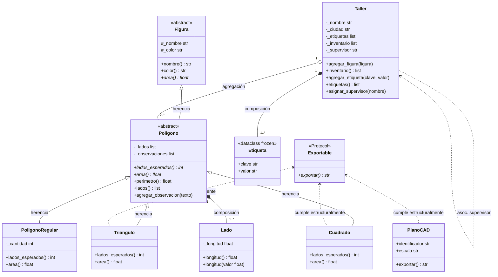

# Modelo Final — Diagrama UML

Dominio completo del TP Integrador POO en Python.

## Notas del diagrama

| Relación | Tipo | Descripción |
| :--- | :--- | :--- |
| `Figura → Poligono` | Herencia | Poligono extiende Figura abstracta |
| `Poligono → Lado` | Composición | Poligono crea y posee sus Lados |
| `Taller → Etiqueta` | Composición | Taller crea las Etiquetas internamente |
| `Taller → Poligono` | Agregación | Taller recibe polígonos ya creados |
| `Taller → supervisor` | Asociación | Referencia débil a un nombre externo |
| `PlanoCAD → Exportable` | Protocol | Cumple estructuralmente sin heredar |
