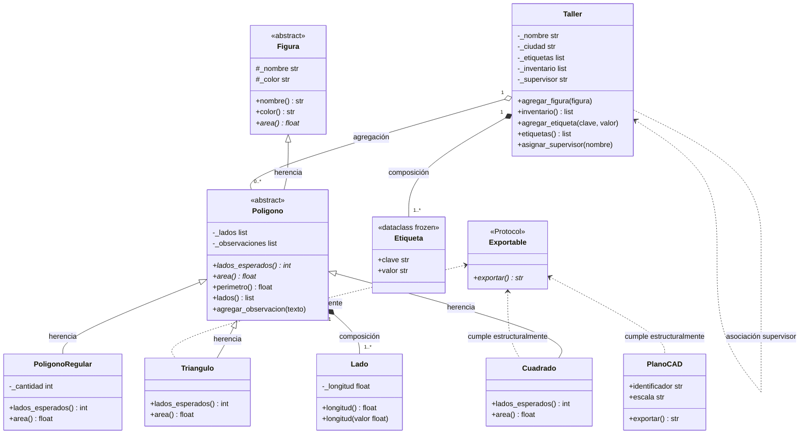

# Informe — TP Integrador: Programación Orientada a Objetos en Python

**Alumno:** Ríos, Brian Emanuel
**Cátedra:** Programación IV — UTN
**Fecha:** Septiembre 2026

---

## Parte 1: Diagnóstico de los 8 Java-ismos

El módulo `parte1_diagnostico.py` ejecuta sin errores, pero contiene ocho decisiones
de diseño heredadas de Java que resultan anti-idiomáticas en Python.

---

### Java-ismo 1 — Getters preventivos sin lógica (`getNombre`, `getColor`)

**Líneas:** 28–33 en `Figura`

**Código original:**
```python
def getNombre(self):
    return self._nombre

def getColor(self):
    return self._color
```

**Inversión conceptual:**
En Java el compilador controla el acceso a los atributos; exponerlos mediante
getters es la única forma de que el mundo exterior los vea sin abrir el campo.
En Python rige el principio de *consenting adults*: si un atributo es público
(sin `_`), se accede directamente; si es protegido (`_nombre`), la convención
ya comunica "no tocar desde fuera sin necesidad". Un getter sin lógica es
ceremonia pura: agrega líneas sin ningún valor.

**Corrección:** eliminar `getNombre()` y `getColor()`. Si en el futuro se
necesita lógica de transformación o validación en la lectura, se añade `@property`.

---

### Java-ismo 2 — getter/setter estilo Java Bean con lógica (`getLongitud`, `setLongitud`)

**Líneas:** 43–49 en `Lado`

**Código original:**
```python
def getLongitud(self):
    return self._longitud

def setLongitud(self, valor):
    if valor <= 0:
        raise ValueError("La longitud debe ser positiva")
    self._longitud = valor
```

**Inversión conceptual:**
Este caso SÍ tiene lógica (validación), por lo que merece protección.
Pero la solución de Java (métodos `getX`/`setX`) obliga al llamador a
escribir `lado.setLongitud(5)` en vez del natural `lado.longitud = 5`.
Python resuelve esto con `@property`: mantiene la sintaxis de atributo
y ejecuta la validación internamente.

**Corrección:**
```python
@property
def longitud(self) -> float:
    return self._longitud

@longitud.setter
def longitud(self, valor: float) -> None:
    if valor <= 0:
        raise ValueError("La longitud debe ser positiva")
    self._longitud = valor
```

---

### Java-ismo 3 — Atributo de clase mutable (`catalogo = []`)

**Línea:** 55 en `Poligono`

**Código original:**
```python
class Poligono(Figura):
    catalogo = []
```

**Inversión conceptual:**
En Java `static` es explícito y el programador sabe que el campo se comparte
entre todas las instancias. En Python, un atributo definido directamente en el
cuerpo de la clase se comparte de la misma manera, pero sin la palabra clave
`static`: es un "static accidental" que puede crecer indefinidamente y causar
*memory leaks* silenciosos. Si se necesita un registro global, debe gestionarse
de forma consciente (atributo de instancia, patrón Registry, etc.).

**Corrección:** eliminar `catalogo = []`. No había ningún consumidor de esa lista
en el código que lo justificara.

---

### Java-ismo 4 — Argumentos por defecto mutables (`lados=[]`, `observaciones=[]`)

**Línea:** 58 en `Poligono.__init__`

**Código original:**
```python
def __init__(self, nombre, color, lados=[], observaciones=[]):
```

**Inversión conceptual:**
En Java cada llamada a un método crea sus propios objetos locales.
En Python, los valores por defecto de los parámetros se evalúan **una sola vez**
al definir la función y se reutilizan en todas las llamadas. Si se usa una lista
mutable como default, todas las instancias que llamen sin argumento **comparten
la misma lista**, con mutaciones invisibles entre instancias.

**Corrección:**
```python
def __init__(self, nombre, color, lados=None, observaciones=None):
    self._lados = list(lados) if lados is not None else []
    self._observaciones = list(observaciones) if observaciones is not None else []
```

---

### Java-ismo 5 — `super().__init__()` omitido

**Líneas:** 60–61 en `Poligono.__init__`

**Código original:**
```python
def __init__(self, nombre, color, lados=[], observaciones=[]):
    # super().__init__() ausente: re-asigna los atributos a mano
    self._nombre = nombre
    self._color = color
```

**Inversión conceptual:**
Java obliga en tiempo de compilación a que el constructor llame a `super()`.
Python no lo exige, pero si se omite y la jerarquía usa `abc.ABC` o múltiple
herencia, el MRO (Method Resolution Order) se rompe silenciosamente o los
atributos de la superclase no se inicializan. Copiar atributos a mano duplica
código y crea una dependencia frágil: si `Figura.__init__` cambia, `Poligono`
no se entera.

**Corrección:**
```python
super().__init__(nombre, color)
```

---

### Java-ismo 6 — Alias sin copia defensiva (`self._lados = lados`)

**Línea:** 63 en `Poligono.__init__` y línea 84–86 en `getLados()`

**Código original:**
```python
self._lados = lados          # guarda el alias, no una copia

def getLados(self):
    return self._lados       # expone el estado interno directamente
```

**Inversión conceptual:**
En Python las listas son objetos mutables pasados por referencia.
Guardar la referencia recibida sin copiarla permite que el llamador
mute el estado interno del objeto desde afuera, rompiendo el encapsulamiento.
Lo mismo ocurre al devolver la lista directa: cualquier `lista[0] = x` externo
modifica la estructura interna del polígono.

**Corrección (doble copia defensiva):**
```python
# Al recibir:
self._lados = list(lados) if lados is not None else []

# Al devolver:
def lados(self) -> list[Lado]:
    return list(self._lados)
```

---

### Java-ismo 7 — Bucle acumulador manual

**Líneas:** 71–75 en `Poligono.perimetro()`

**Código original:**
```python
def perimetro(self):
    total = 0
    for l in self._lados:
        total = total + l.getLongitud()
    return total
```

**Inversión conceptual:**
El bucle acumulador es el patrón imperativo de Java/C para sumar colecciones.
Python provee `sum()` con expresiones generadoras: más declarativo (expresa
*qué* se quiere, no *cómo* se hace), más legible y más eficiente en memoria
porque el generador evalúa cada valor de forma perezosa.

**Corrección:**
```python
def perimetro(self) -> float:
    return sum(lado.longitud for lado in self._lados)
```

---

### Java-ismo 8 — Sobrecarga de constructor con ramas `isinstance`

**Líneas:** 90–97 en `Triangulo.__init__` y 103–110 en `Cuadrado.__init__`

**Código original:**
```python
def __init__(self, *args):
    if len(args) == 3:
        super().__init__(args[0], args[1], args[2])
    elif len(args) == 1 and isinstance(args[0], list):
        super().__init__("triángulo", "negro", args[0])
    else:
        super().__init__("triángulo", "negro", [])
```

**Inversión conceptual (el que NO estaba en el checklist del video):**
En Java no existe parámetros con valor por defecto ni keyword arguments, por
lo que la única forma de tener múltiples firmas es la sobrecarga de métodos
(o el patrón Builder). En Python, el mecanismo nativo son los **keyword
arguments con defaults** y, cuando se necesitan constructores alternativos
con semántica radicalmente distinta, los **classmethods**. El `isinstance`
dentro del `__init__` es firmar un contrato que nadie puede leer: el IDE
no puede inferir qué tipo retorna ni qué parámetros acepta.

**Corrección:**
```python
def __init__(
    self,
    nombre: str = "triángulo",
    color: str = "negro",
    lados: list[Lado] | None = None,
) -> None:
    super().__init__(nombre, color, lados)
```

---

### Ruido sintáctico (no cuenta como java-ismo de diseño)

| Tipo de ruido | Línea | Corrección |
| :--- | :--- | :--- |
| Punto y coma al final de línea | 140 | eliminar `;` |
| Comparación contra `True` | 139 | `if activo:` |
| Concatenación con `+` en lugar de f-string | 142–148 | `f"Perímetro: {t.perimetro()}"` |
| Type hint mentiroso `-> int` que retorna `str` | 78 | corregir a `-> float` o hacer `@abstractmethod` |

---

## Parte 2: Relaciones Estructurales — `Taller` y `Etiqueta`

### Etiqueta — `@dataclass(frozen=True)`

`Etiqueta` es un *value object*: solo importa su valor, no su identidad.
`frozen=True` impide la reasignación de atributos post-construcción y habilita
el hash automático, lo que permite usar `Etiqueta` en sets y como clave de dict.

### Taller — tres relaciones en un único constructor

| Relación | Ejemplo en código | Justificación |
| :--- | :--- | :--- |
| **Composición** | `Etiqueta` creada dentro de `__init__` | La Etiqueta no tiene sentido fuera del Taller; ciclo de vida dependiente |
| **Agregación** | `agregar_figura()` recibe un polígono ya creado | El polígono existe antes y puede sobrevivir al Taller |
| **Asociación** | `asignar_supervisor(nombre: str)` | Referencia débil; el Taller conoce pero no posee ni crea al supervisor |

**Copia defensiva** aplicada en:
- `inventario()` → `return list(self._inventario)`
- `etiquetas()` → `return list(self._etiquetas)`

---

## Parte 3: Jerarquía con `abc.ABC` — Falla Temprana

`Figura` y `Poligono` se convierten en clases abstractas mediante `abc.ABC`.
`area()` y `lados_esperados()` son `@abstractmethod`: Python lanza `TypeError`
al intentar instanciar cualquier clase que no los implemente. Esto es la
inversión del java-ismo #8 original: en vez de un `area()` que silenciosamente
retorna `0.0` o un string incorrecto, el intérprete falla **al construir**
la instancia, no al llamar el método.

### Decisión sobre `PoligonoRegular`

Se **mantiene la herencia** de `Poligono`. Justificación:

- Un polígono regular **ES-UN** polígono tanto por dominio como por comportamiento:
  tiene lados, perímetro y área calculables con las mismas reglas.
- La herencia no es un truco de compilador: aporta duck typing seguro dentro de
  la jerarquía. Cualquier función que reciba `Poligono` puede recibir
  `PoligonoRegular` sin necesitar `isinstance`.
- Si en el futuro el dominio diferencia radicalmente ambos (p. ej., un
  `PoligonoRegular` no admite lados de distinta longitud), se puede reemplazar
  por composición o por un `Protocol` propio.

---

## Parte 4: Contrato `Exportable` con `typing.Protocol`

### Por qué `Protocol` y no `ABC`

| Criterio | `ABC` | `Protocol` |
| :--- | :--- | :--- |
| Require herencia explícita | Sí | No |
| Funciona con clases de terceros | No | **Sí** |
| Verificable en runtime | Sí (con `isinstance`) | Sí (con `@runtime_checkable`) |
| Verificable con mypy | Sí | **Sí (structural subtyping)** |

`PlanoCAD` ya tiene `exportar() -> str` pero no hereda de ninguna clase nuestra
y **no se puede modificar**. Una `ABC` fallaría porque exigiría que `PlanoCAD`
heredara de `Exportable`. `Protocol` verifica estructuralmente: si el objeto
tiene el método con la firma correcta, cumple el contrato.

---

## Parte 5: Suite de Tests — Decisiones de Diseño Testeadas

| Test | Decisión que verifica |
| :--- | :--- |
| `test_figura_no_se_puede_instanciar` | `Figura` es `ABC` → falla temprana |
| `test_poligono_no_se_puede_instanciar` | `Poligono` es `ABC` → falla temprana |
| `test_lados_devuelve_copia` | Copia defensiva en `Poligono.lados()` |
| `test_taller_inventario_devuelve_copia` | Copia defensiva en `Taller.inventario()` |
| `test_triangulos_con_default_no_comparten_lados` | Default mutable corregido |
| `test_planocad_es_exportable` | `Protocol` estructural sin herencia |
| `test_planocad_no_hereda_de_clases_propias` | `Protocol` vs `ABC` |
| `test_exportar_todos_acepta_planocad_y_poligonos` | Función genérica sobre `Exportable` |
| `test_etiqueta_no_se_puede_mutar` | `frozen=True` en `Etiqueta` |
| `test_etiqueta_es_hashable` | Beneficio de `frozen=True` |
| `test_area_triangulo_heron` | Implementación numérica correcta |
| `test_area_cuadrado` | Implementación numérica correcta |
| `test_area_hexagono_regular` | Implementación numérica correcta |
| `test_lado_rechaza_cero` | Validación en `Lado.__init__` |
| `test_lado_rechaza_negativo` | Validación en `Lado.__init__` |
| `test_lado_acepta_positivo` | Caso positivo de `Lado` |

---

## Diagrama UML Final


